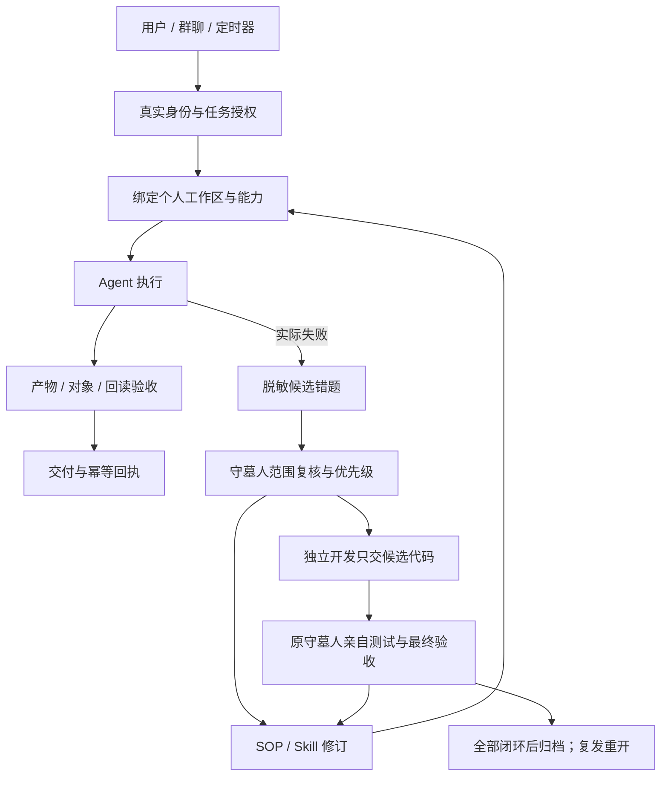

# Agent Workspace Framework

**把 Agent 从一次性对话，变成可持续运行、可复盘、可治理的项目工作区。**

一句启动提示词、一份可执行框架、三个 Skill：复现任务入口、成员空间、权限控制、定时任务、共享错题本、守墓人治理和 SOP 沉淀的完整闭环。源码提炼自持续运行的实际项目，包含桥接、调度、账本和回归测试；不包含原项目成员信息、凭据、聊天、业务数据或运行状态。

> **一句话给 Agent：** 克隆 `https://github.com/AIDiscovery007/agent-workspace-framework`，完整阅读 `BOOTSTRAP.md`，使用 `skills/workspace-bootstrap/SKILL.md` 在我指定的工作区部署并逐项验收这套自动化体系；复用已有授权，只询问缺失的真实账号和配置，外部依赖未通过时明确保留待验收项。

## 先跑起来

需要 **Python 3.11+**；macOS 若 `python3` 是系统 3.9，请改用已安装的 `python3.13`。以下操作不会登录外部平台、启动 Agent 或创建常驻服务。

```bash
git clone https://github.com/AIDiscovery007/agent-workspace-framework.git
cd agent-workspace-framework
python3 scripts/aw.py init --root ../my-agent-workspace --profile core
python3 scripts/aw.py doctor --root ../my-agent-workspace
python3 scripts/demo.py
python3 scripts/verify.py
```

`core` 安装完整目录、规则、Skill、空错题库和运行源码；保持服务关闭。`demo.py` 在临时目录演示候选提交与去重，退出后删除夹具。`verify.py` 在全新临时部署跑回归，不访问现有工作区。`--node` 额外安装锁定的 `ws` 依赖并验证传输。

需要完整的手机/群聊入口与后台运行：按 [部署手册](docs/deployment.md) 使用 `full` 配置。已有项目使用 [迁移与升级](docs/upgrade.md)，不要对现有状态目录再次初始化。

## 体系包含什么

| 层 | 实现与规则 | 对应入口 |
| --- | --- | --- |
| 指令层 | 简短 AGENTS 索引、按需读取 SOP/Skill、资料不转移权限 | [模板](templates/AGENTS.md) |
| 入口层 | 真正 @、规范消息回读、WS + 轮询补漏、多群路由、持久去重 | [Hi 桥接](runtime/hi-bridge/bridge.py) |
| 成员层 | 精确账号准入、群×成员会话、个人文件目录、共享只读规则 | [成员权限](runtime/hi-bridge/member_access.py) |
| 能力层 | 按账号浏览器、固定网盘目录、可信代理、本人资源回读 | [权限模型](docs/permissions.md) |
| 自动化层 | 文件整理、工作日日报、依赖日报的周报、补跑与准确会话清理 | [定时任务](runtime/tasks) |
| 反馈层 | 候选错题、去重、范围复核、优先级、独立事件计数 | [账本](runtime/gravekeeper/notebook.py) |
| 治理层 | 全新守墓人、独立开发、原守墓人亲自测试、受控应用、最终验收 | [治理流程](docs/governance.md) |
| 知识层 | 修复后更新 SOP/Skill，根指令只留短索引 | [SOP Skill](skills/standardize-sop/SKILL.md) |
| 交付层 | 产物与元数据核验、来源群回复、任务通知身份分工 | [交付 SOP](templates/SOP/小红书机器人发送文件链接SOP.md) |



## “任意 Agent”和“100% 复现”的准确含义

**部署者可替换，已验证执行适配器有明确前提。** 能读文件、执行命令、编辑配置的 Codex、Claude Code、Cursor 等 Agent 都能遵循同一 Skill 完成部署；没有工具权限的纯聊天 Agent 无法执行安装。

通用部分是规则、目录、配置、错题账本、权限契约和验收方法。完整参考执行栈使用 **macOS + Codex CLI/App Server + Hi CLI/应用机器人 + Herdr**。Hi 与 Herdr 的获取、企业授权、模型额度和登录状态由部署者提供，仓库不分发这些平台或作者凭据。Linux 可运行 core 和测试；Windows 原生服务、其他 IM、其他模型执行器尚无经过验收的适配器。

“100%”对应 [复现验收矩阵](docs/acceptance.md) 中当前启用范围的全部条目通过；**不承诺任意机器、任意账号、任意 Agent 零配置必成**。单元测试通过不等于新机器的真实群任务或权限隔离已验收。外部项缺证据时保持 pending，而不是填造 passed。

## 阅读路径

- 交给 Agent：[BOOTSTRAP.md](BOOTSTRAP.md) → [workspace-bootstrap](skills/workspace-bootstrap/SKILL.md)
- 理解设计：[架构与不变量](docs/architecture.md) → [权限](docs/permissions.md) → [治理](docs/governance.md)
- 实际部署：[部署](docs/deployment.md) → [验收](docs/acceptance.md) → [迁移升级](docs/upgrade.md)
- 更换平台：[适配器契约](docs/adapters.md)
- 代码来源与抽取取舍：[提炼说明](docs/extraction.md)
- 本次实际验证与未验收边界：[验证记录](docs/verification.md)

MIT License · Author: AIDiscovery007。第三方服务和依赖遵循各自许可；本项目不代表 Hi、Herdr 或 OpenAI 的官方发行版。
